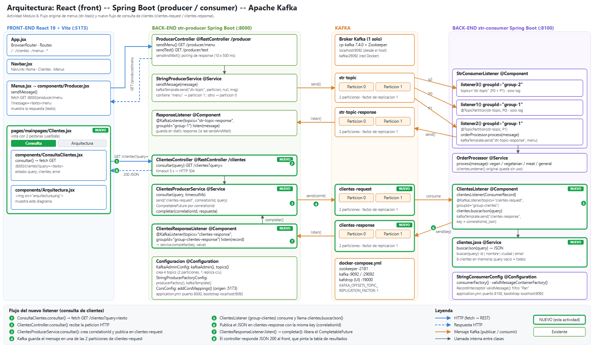

# Análisis del sistema Kafka, Módulo 8

En este documento explico cómo está armado el sistema, dónde está cada pieza de Kafka dentro del código y qué agregué para la consulta de clientes.

El sistema tiene tres partes. El front-end es una app de React que está en la carpeta frontProducerKafka. El back-end son dos aplicaciones de Spring Boot dentro de kafkaExample: str-producer, que corre en el puerto 8000, y str-consumer, que corre en el 8100. Por último está Kafka con su Zookeeper y Kafdrop, que se levantan con Docker. Las rutas de Java que menciono salen de kafkaExample/<módulo>/src/main/java/com/lta/backend/.

## Parte 1. Cómo levanté el sistema

Primero levanté Kafka, Zookeeper y Kafdrop con docker compose up -d dentro de kafkaExample. Con docker ps vi que los tres contenedores estaban arriba y Kafdrop abrió bien en http://localhost:19000.

En mi computadora no hay Java ni Maven, así que str-producer y str-consumer los compilé y los corrí en Docker, con una imagen de Maven y JDK 17, conectados a la misma red que Kafka. Para comprobar que funcionaban llamé a /producer/menu?message=veganmenu y me regresó el menú vegano. En los logs del consumer también aparecían los listeners con sus particiones asignadas.

El front lo levanté con npm install y npm run dev. Aquí tuve que instalar a mano react-router-dom, porque App.jsx y Navbar.jsx lo usan pero no estaba en el package.json. Con eso las rutas /, /clientes y /menus cargaron bien.

## Parte 2. Dónde está cada componente de Kafka

### Producer

El producer es el que manda mensajes a Kafka y vive en str-producer. La configuración está en StringProducerFactoryConfig: el método producerFactory() define la dirección del broker y usa StringSerializer para convertir los textos a bytes, y el método kafkaTemplate() crea el KafkaTemplate, que es la herramienta con la que se envía.

Quien envía es StringProducerService, en el método sendMessage(String message), que llama a kafkaTemplate.send("str-topic", partition, null, message). A ese método lo dispara ProducerController, que recibe la petición HTTP y lo llama a través de sendAndWait().

El topic de destino es str-topic. Lo curioso es que el código elige la partición a mano: si el mensaje contiene la palabra "menu" va a la partición 1 y si no, a la 0. Como Producer.jsx siempre le agrega "menu" al texto, en la práctica todo lo que manda el front cae en la partición 1.

### Consumer

El consumer es el que lee mensajes y está en str-consumer. Su configuración está en StringConsumerConfig, que tiene consumerFactory(), con el StringDeserializer, y validMessageContainerFactory(), la fábrica que usan los listeners. Los métodos que consumen son listener1(), listener2() y listener3(), dentro de StrConsumerListener.

Los grupos de consumidores son dos. listener1 y listener2 pertenecen a group-1, y listener3 pertenece a group-2. Algo que me ayudó a entender esto es que, como son grupos distintos, cada grupo recibe todos los mensajes de str-topic. Dentro de un mismo grupo los mensajes se reparten: listener1 solo lee la partición 0 y listener2 solo la 1, así que no se pisan, mientras que listener3 lee las dos.

El producer también tiene su propio consumer, que es ResponseListener.listen() en str-producer. Escucha las respuestas en str-topic-response con el grupo group-1. Usa el mismo nombre de grupo, pero como es otra aplicación y otro topic no choca con los del consumer.

### Topics

Los topics se crean desde el código, en KafkaAdminConfig.topics(), dentro de str-producer. Ahí se usa TopicBuilder y Spring los crea cuando arranca la aplicación. También se podrían crear a mano desde la consola, como explica el readme.

Hay cuatro. str-topic recibe las peticiones de menú y str-topic-response regresa el menú sugerido, y ambos ya venían en el proyecto. clientes-request recibe las consultas de clientes y clientes-response regresa el resultado, y estos dos los agregué yo.

### Particiones

Todos los topics tienen 2 particiones, que se configuran en el mismo lugar con .partitions(2) dentro de KafkaAdminConfig.topics().

El proyecto usa las dos formas de trabajar con particiones. Al publicar, StringProducerService le pasa a kafkaTemplate.send() el número de partición. Al consumir, listener1 y listener2 usan @TopicPartition(topic = "str-topic", partitions = {"0"}), o {"1"}, para quedarse con una partición fija.

### Réplicas

El factor de replicación es 1 en los cuatro topics, con .replicas(1) en KafkaAdminConfig.topics(). El docker-compose.yml también lo fija para el topic interno de offsets con KAFKA_OFFSETS_TOPIC_REPLICATION_FACTOR: 1.

Es 1 porque solo hay un broker (KAFKA_BROKER_ID: 1). No se pueden tener más réplicas que brokers, porque no habría dónde guardarlas. En un sistema real se usarían 3 brokers con factor 3, para que todo siga funcionando si uno se cae.

### Listeners

Un listener es un método marcado con @KafkaListener que Spring ejecuta cada vez que llega un mensaje. En el proyecto hay estos:

listener1, en StrConsumerListener.listener1(), lee la partición 0 de str-topic con el grupo group-1 y solo escribe el mensaje en el log.

listener2, en StrConsumerListener.listener2(), lee la partición 1 con el grupo group-1. Llama a OrderProcessor.process() para elegir el menú y lo publica en str-topic-response. Es el único que responde.

listener3, en StrConsumerListener.listener3(), lee todo str-topic con el grupo group-2 y solo escribe en el log.

ResponseListener.listen(), en str-producer, recibe la respuesta de str-topic-response y la guarda en una variable.

ClientesListener.clientesListener(), en str-consumer, es el listener nuevo que atiende las consultas de clientes con el grupo group-clientes.

ClientesResponseListener.listen(), en str-producer, también es nuevo y recibe el resultado de clientes con el grupo group-clientes-response.

Otro detalle es que StringConsumerConfig.validMessage() es un RecordInterceptor, una especie de filtro que se ejecuta antes del listener. Escribe un aviso en el log si el mensaje contiene "Pan", pero no descarta nada: todos los mensajes llegan igual al listener.

### Cómo viaja un mensaje en el flujo original de menús

En /menus, Producer.jsx llama a GET :8000/producer/menu?message=<texto>menu. ProducerController.sendMenu() le pasa el texto a StringProducerService.sendMessage(), que lo publica en str-topic, partición 1. Ahí lo lee listener2, y OrderProcessor.process() decide el menú según palabras como vegan, vegetarian o meat. Luego listener2 publica ese menú en str-topic-response y ResponseListener.listen() lo recibe y lo guarda. Mientras tanto el controller espera con un bucle, hasta 10 veces con pausas de 500 ms, y cuando tiene la respuesta se la devuelve al navegador.

## Parte 3. Lo que agregué: consulta de clientes

La actividad pedía una vista con dos pestañas, donde la de consulta mandara la búsqueda por Kafka y la atendiera un listener nuevo. Elegí clientes porque el front ya tenía la ruta /clientes vacía.

Las dos pestañas están en Clientes.jsx. La de Consulta es el componente ConsultaClientes.jsx: un campo de texto y un botón, que permite buscar por id, nombre, ciudad o email, y si se deja vacío regresa todos. La de Arquitectura es Arquitectura.jsx, que muestra el diagrama de la Parte 4.

Una consulta recorre este camino. ConsultaClientes.consultar() hace GET :8000/clientes?query=<texto>. ClientesController.consultar() llama a ClientesProducerService.consultar(), que genera un identificador único (el correlationId), deja preparado un CompletableFuture, que es como una casilla donde se va a guardar la respuesta, y publica la consulta en clientes-request usando ese identificador como key del mensaje.

El listener nuevo, ClientesListener.clientesListener() en str-consumer, recibe la consulta, busca los clientes con clientes.buscarJson() y publica el resultado en clientes-response con la misma key. Después ClientesResponseListener.listen() recibe esa respuesta, usa la key para saber a qué consulta pertenece y llama a ClientesProducerService.completar(), que llena la casilla. El controller, que estaba esperando, responde al navegador con el JSON. Si pasan 5 segundos sin respuesta devuelve un error 504, y el front dibuja una tabla con el resultado.

Usé un identificador en lugar de copiar el método original porque el flujo de menús guarda la respuesta en una variable static compartida (ResponseListener.response). Si dos personas consultan al mismo tiempo, una respuesta puede pisar a la otra. Con el correlationId cada petición espera solo su propia respuesta, y además el CompletableFuture evita el bucle con Thread.sleep. El flujo de menús lo dejé como estaba.

Para probarlo hice varias consultas. Con la búsqueda vacía regresó los 8 clientes. Con "monterrey" regresó 2 (Ana Torres y Carlos Mendez), con "3" regresó 1 (Maria Lopez) y con "zzz" regresó una lista vacía. El flujo de menús siguió funcionando, el back-end aceptó las peticiones que vienen del front en localhost:5173 (CORS), y las rutas /, /clientes y /menus cargan bien con la pestaña de Consulta visible.

## Parte 4. Diagrama de arquitectura

El diagrama muestra el sistema completo de izquierda a derecha: el front, str-producer, Kafka y str-consumer. Lo nuevo está resaltado en verde y numerado del 1 al 8 para seguir el recorrido de una consulta de clientes. Los archivos son arquitectura.png y arquitectura.svg, en esta misma carpeta.

## Cosas que noté mientras lo revisaba

La variable static del producer se pisa si hay peticiones simultáneas, y eso es justo lo que evité en el flujo nuevo. Con replicación 1 el sistema no tolera la caída del broker; en un caso real habría que subirla, pero eso necesita más de un broker.

El archivo clientes.java del consumer ya existía con una copia del código de menús que nadie usaba. Lo aproveché para la lógica de clientes y dejé intacto su método original ordenar().

Por último, el lint del front marca un error que ya venía en el repo: Default.jsx importa useState sin usarlo. No lo toqué porque no es parte de la actividad, y el build pasa sin problema.
